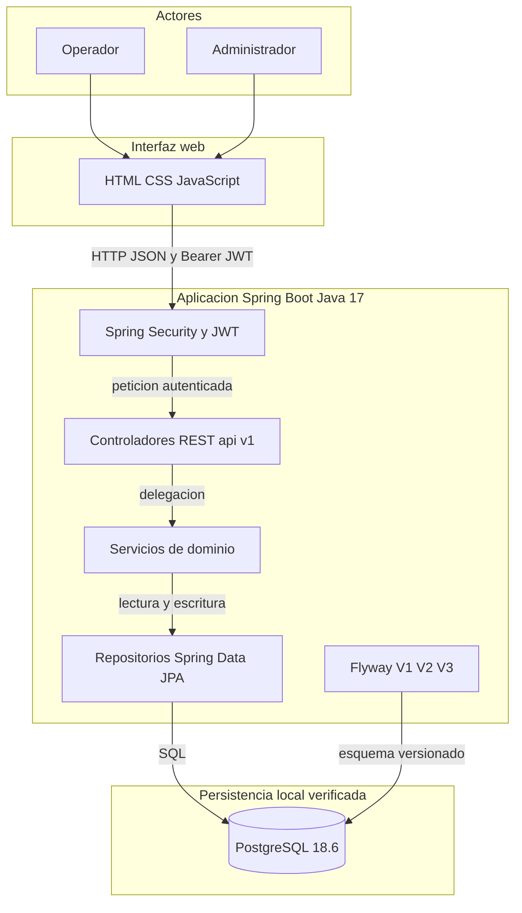
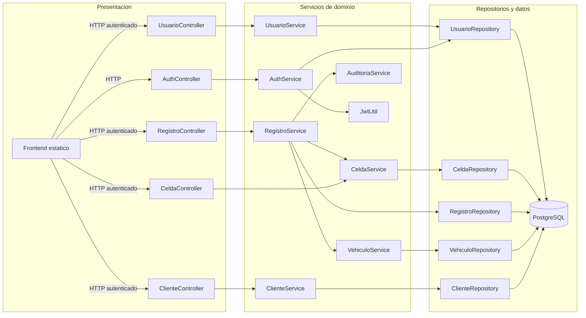
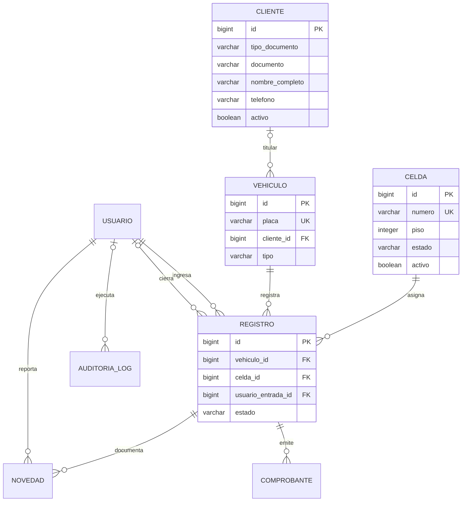

# Diagramas UML y de arquitectura — Iteración 2

**Proyecto:** Autos Colombia
**Estado de la evidencia:** diagramas Mermaid editables y renderizables en GitHub. El archivo nativo `.mdj` se conserva, pero no se declara visualmente validado en StarUML.

Estos diagramas describen la arquitectura y los flujos comprobados en el código de Iteración 2. La ejecución real en PostgreSQL comprobó V1–V3 y el flujo de cliente, entrada y salida sintéticos; no implica que todas las escrituras administrativas hayan sido ejecutadas en producción.

## 1. Arquitectura de aplicación

<!-- mermaid-checked: no \n, no em-dash/en-dash, no {} in labels, subgraphs are id["label"], arrows are -->|"label"|, all subgraphs closed by end, ids unique -->


### Decisiones representadas

- La interfaz estática se sirve desde la misma aplicación Spring Boot.
- Los controladores delegan reglas a servicios; los repositorios encapsulan el acceso JPA.
- Flyway administra el esquema. `ddl-auto: validate` comprueba el mapeo sin sustituir las migraciones.
- El despliegue PostgreSQL verificado fue local. No se representa una nube ni un proveedor externo.

## 2. Relaciones entre componentes

<!-- mermaid-checked: no \n, no em-dash/en-dash, no {} in labels, subgraphs are id["label"], arrows are -->|"label"|, all subgraphs closed by end, ids unique -->


El filtro JWT intercepta las solicitudes protegidas antes de que alcancen los controladores y consulta `AuthService` para validar la cuenta. Las operaciones de negocio que escriben usan transacciones; la auditoría se registra junto con ellas.

## 3. Secuencia: crear cliente y registrar entrada

<!-- mermaid-checked: every participant uses `participant Id as "Label"`, no \n in aliases/messages/notes, every alt/opt/loop closed by end, no `:` inside any alias -->
```mermaid
sequenceDiagram
    autonumber
    participant Actor as "Administrador u operador"
    participant UI as "Frontend"
    participant Filter as "JwtAuthenticationFilter"
    participant Auth as "AuthService"
    participant UserRepo as "UsuarioRepository"
    participant ClientCtrl as "ClienteController"
    participant ClientSvc as "ClienteService"
    participant ClientRepo as "ClienteRepository"
    participant RegCtrl as "RegistroController"
    participant RegSvc as "RegistroService"
    participant VehSvc as "VehiculoService"
    participant CellSvc as "CeldaService"
    participant RegRepo as "RegistroRepository"
    participant Receipt as "ComprobanteService"
    participant Audit as "AuditoriaService"
    participant DB as "PostgreSQL"

    Actor->>UI: Captura datos del cliente
    UI->>Filter: POST api v1 clientes con JWT
    Filter->>Auth: validarToken
    Auth->>UserRepo: buscar cuenta activa
    UserRepo->>DB: consultar usuario
    DB-->>UserRepo: usuario activo
    UserRepo-->>Auth: usuario
    Auth-->>Filter: identidad autenticada
    Filter->>ClientCtrl: entregar solicitud autenticada
    ClientCtrl->>ClientSvc: crear ficha
    ClientSvc->>ClientRepo: guardar cliente
    ClientRepo->>DB: INSERT cliente
    DB-->>ClientRepo: cliente persistido
    ClientRepo-->>ClientSvc: cliente
    ClientSvc-->>ClientCtrl: ClienteDTO
    ClientCtrl-->>UI: 201 creado

    Actor->>UI: Selecciona titular y registra QWE123
    UI->>Filter: POST api v1 registros entrada con clienteId
    Filter->>Auth: validarToken
    Auth->>UserRepo: buscar cuenta activa
    UserRepo->>DB: consultar usuario
    DB-->>UserRepo: usuario activo
    UserRepo-->>Auth: usuario
    Auth-->>Filter: identidad autenticada
    Filter->>RegCtrl: entregar solicitud autenticada
    RegCtrl->>RegSvc: registrarEntrada
    RegSvc->>RegRepo: buscar registro activo por placa
    RegRepo->>DB: consultar registro
    DB-->>RegRepo: sin registro activo
    RegRepo-->>RegSvc: resultado
    RegSvc->>VehSvc: crear o actualizar y vincular titular
    VehSvc->>DB: persistir vehiculo y relacion cliente
    DB-->>VehSvc: vehiculo vinculado
    VehSvc-->>RegSvc: vehiculo
    RegSvc->>CellSvc: asignar celda libre del tipo
    CellSvc->>DB: bloquear y ocupar celda
    DB-->>CellSvc: celda A-01
    CellSvc-->>RegSvc: celda asignada
    RegSvc->>RegRepo: guardar estancia ACTIVO
    RegRepo->>DB: INSERT registro
    DB-->>RegRepo: registro persistido
    RegSvc->>Receipt: generar comprobante de entrada
    Receipt->>DB: guardar comprobante QR
    DB-->>Receipt: comprobante persistido
    RegSvc->>Audit: registrar entrada
    RegSvc-->>RegCtrl: RegistroDTO
    RegCtrl-->>UI: 201 entrada confirmada y QR
```

## 4. Secuencia: registrar salida y liberar la celda

<!-- mermaid-checked: every participant uses `participant Id as "Label"`, no \n in aliases/messages/notes, every alt/opt/loop closed by end, no `:` inside any alias -->
```mermaid
sequenceDiagram
    autonumber
    participant Actor as "Operador"
    participant UI as "Frontend"
    participant Filter as "JwtAuthenticationFilter"
    participant Auth as "AuthService"
    participant RegCtrl as "RegistroController"
    participant RegSvc as "RegistroService"
    participant RegRepo as "RegistroRepository"
    participant CellSvc as "CeldaService"
    participant Receipt as "ComprobanteService"
    participant Audit as "AuditoriaService"
    participant DB as "PostgreSQL"

    Actor->>UI: Busca placa QWE123
    UI->>Filter: PUT api v1 registros salida QWE123 con JWT
    Filter->>Auth: validarToken y cuenta activa
    Auth-->>Filter: identidad autenticada
    Filter->>RegCtrl: entregar solicitud
    RegCtrl->>RegSvc: registrarSalida
    RegSvc->>RegRepo: buscar registro ACTIVO
    RegRepo->>DB: consultar estancia y celda
    DB-->>RegRepo: estancia ACTIVA en A-01
    RegRepo-->>RegSvc: registro
    RegSvc->>RegRepo: cambiar estado a CERRADO
    RegRepo->>DB: UPDATE registro y fecha de salida
    DB-->>RegRepo: registro cerrado
    RegSvc->>CellSvc: liberar solo celda del registro
    CellSvc->>DB: bloquear y poner A-01 DISPONIBLE
    DB-->>CellSvc: celda disponible
    RegSvc->>Receipt: generar comprobante de salida QR
    Receipt->>DB: guardar comprobante
    DB-->>Receipt: comprobante persistido
    RegSvc->>Audit: registrar salida
    RegSvc-->>RegCtrl: RegistroDTO CERRADO
    RegCtrl-->>UI: 200 salida confirmada
    UI-->>Actor: muestra duración y liberación
```

## 5. Modelo de datos de Iteración 2



La relación `CLIENTE`–`VEHICULO` es opcional desde el lado del vehículo para conservar vehículos históricos sin titular. Los índices únicos parciales de V3 permiten como máximo una estancia `ACTIVO` por vehículo y por celda; los registros cerrados se mantienen como historial.

## 6. Relación con el archivo StarUML

El archivo `docs/staruml/AutosColombia_Iteraciones1y2.mdj` aún tiene diagramas declarados sin elementos de vista y no se afirma que esté validado en StarUML. Este documento aporta diagramas Mermaid editables y renderizables, pero **no sustituye** una exportación visual StarUML si la rúbrica exige específicamente ese formato. Para completar esa evidencia nativa se requiere abrir el `.mdj` con StarUML, construir sus vistas gráficas y exportarlas; StarUML no está instalado en el entorno de verificación actual.
